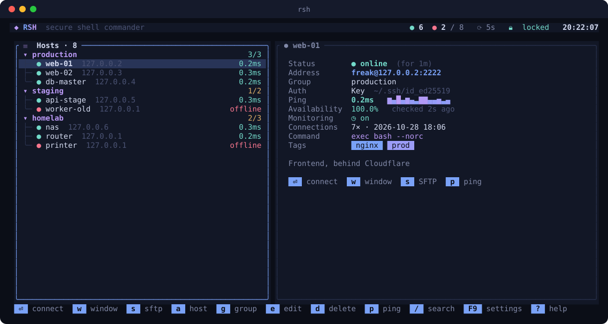
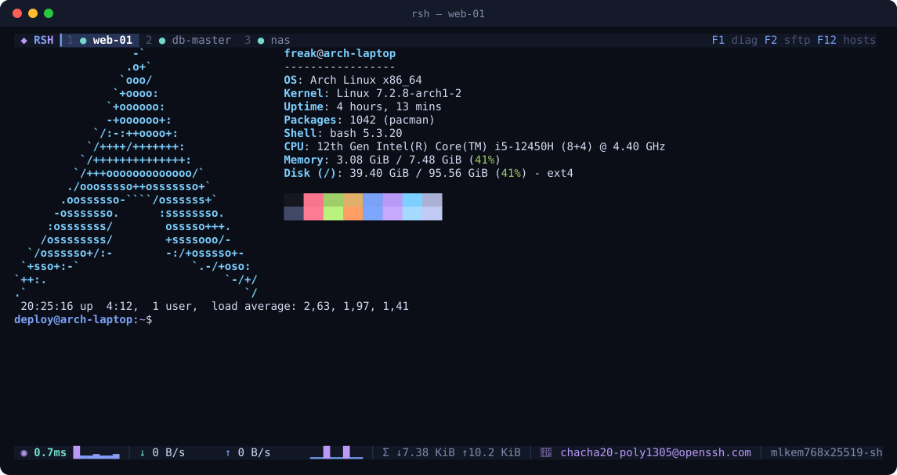
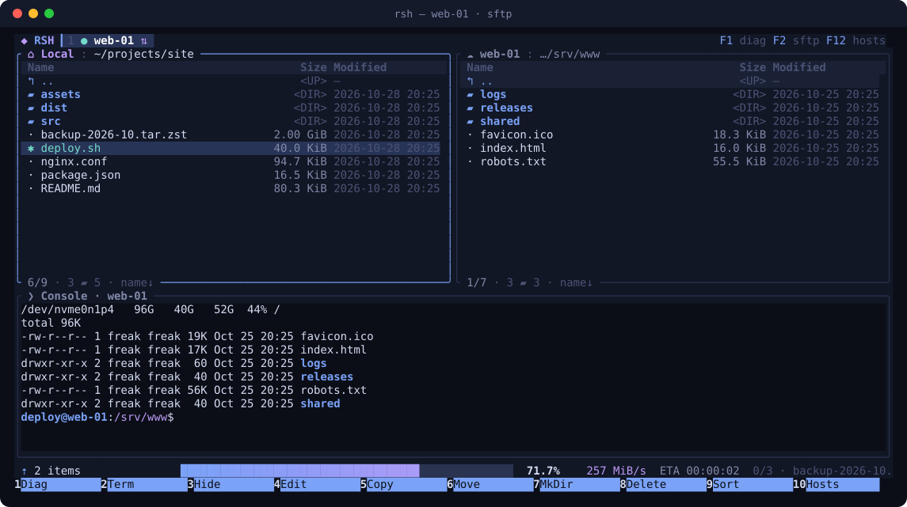
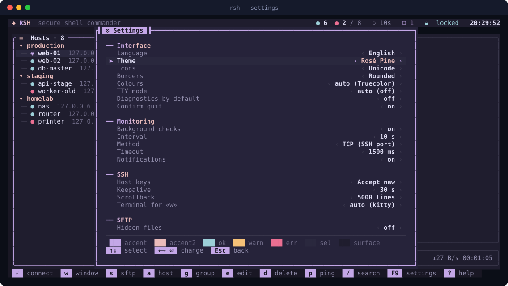

<div align="center">


### SSH-коммандер для терминала, который выглядит так же хорошо, как работает

Дерево хостов · шифрованное хранилище · встроенный терминал · SFTP в стиле Total Commander · мониторинг


[](https://github.com/sanchyous/rsh/actions/workflows/ci.yml)
[](https://github.com/sanchyous/rsh/releases/latest)


[English](README.md) · **Русский**

</div>

<br>

<p align="center"></p>

## Зачем

`~/.ssh/config` помнит, где живут серверы. Но он не покажет, какие из них сейчас в сети, не сбережёт пароли, а чтобы
скопировать файл, всё равно нужна вторая программа. RSH собирает всё это в одном экране, которым управляют с клавиатуры:

- **Хосты деревом.** Группы и подгруппы, у каждого хоста живой статус и задержка, поиск.
- **Секреты в настоящем хранилище.** Argon2id + XChaCha20-Poly1305 под одним мастер-паролем, на диск ничего не попадает в открытом виде.
- **Терминал, который не мешает.** Полная эмуляция xterm во вкладках, <kbd>F1</kbd> добавляет строку диагностики.
- **Файлы, не выходя из сессии.** <kbd>F2</kbd> превращает то же подключение в двухпанельный SFTP-коммандер,
  <kbd>F3</kbd> открывает под ним консоль.
- **Работает в любом терминале.** От truecolor до голой консоли Linux, 18 тем, иконки Nerd Font или чистый ASCII.

## Скриншоты

<table>
<tr>
<td width="50%"></td>
<td width="50%"></td>
</tr>
<tr>
<td align="center"><sub>Вкладки, эмуляция xterm и строка диагностики <kbd>F1</kbd></sub></td>
<td align="center"><sub>SFTP-коммандер <kbd>F2</kbd> с передачей файлов и консолью <kbd>F3</kbd></sub></td>
</tr>
<tr>
<td colspan="2"></td>
</tr>
<tr>
<td colspan="2" align="center"><sub>Настройки применяются сразу, тут — тема Rosé Pine с превью палитры</sub></td>
</tr>
</table>

## Установка

**Linux: одна команда для любого дистрибутива** (сама определит пакетный менеджер и архитектуру, проверит контрольную сумму):

```bash
curl -fsSL https://github.com/sanchyous/rsh/releases/latest/download/install.sh | sh
```

**Windows: одна команда в PowerShell** (без прав администратора; ставит в `%LOCALAPPDATA%\Programs\rsh` и добавляет в `PATH`):

```powershell
irm https://github.com/sanchyous/rsh/releases/latest/download/install.ps1 | iex
```

<details>
<summary><b>Или выбрать пакет вручную</b></summary>

<br>

**Debian / Ubuntu / Mint / Pop!_OS**
```bash
curl -fLO https://github.com/sanchyous/rsh/releases/latest/download/rsh_amd64.deb   # arm64: rsh_arm64.deb
sudo apt install ./rsh_amd64.deb
```

**Fedora / RHEL / Rocky / Alma**
```bash
sudo dnf install https://github.com/sanchyous/rsh/releases/latest/download/rsh-x86_64.rpm   # или rsh-aarch64.rpm
```

**openSUSE**
```bash
curl -fLO https://github.com/sanchyous/rsh/releases/latest/download/rsh-x86_64.rpm
sudo zypper install --allow-unsigned-rpm ./rsh-x86_64.rpm
```

**Arch / Manjaro / EndeavourOS / CachyOS**
```bash
curl -fLO https://github.com/sanchyous/rsh/releases/latest/download/rsh-x86_64.pkg.tar.zst
sudo pacman -U ./rsh-x86_64.pkg.tar.zst
```
PKGBUILD для AUR (`rsh` — сборка из исходников, `rsh-bin` — готовый бинарник) лежат в [`packaging/aur`](packaging/aur).

**Alpine**
```bash
wget https://github.com/sanchyous/rsh/releases/latest/download/rsh-x86_64.apk
sudo apk add --allow-untrusted ./rsh-x86_64.apk
```

**Любой Linux: статический бинарник, без root**
```bash
curl -fsSL https://github.com/sanchyous/rsh/releases/latest/download/install.sh | RSH_INSTALL_METHOD=tarball RSH_PREFIX=~/.local sh
```

**Windows: MSI-установщик** (для всей системы, добавляет `rsh` в `PATH`, удаляется через «Приложения и возможности»): скачайте `rsh-x86_64.msi` или `rsh-aarch64.msi` из [последнего релиза](https://github.com/sanchyous/rsh/releases/latest) и запустите, или тихо:
```powershell
irm https://github.com/sanchyous/rsh/releases/latest/download/rsh-x86_64.msi -OutFile rsh.msi; msiexec /i rsh.msi /qn
```

**Windows: Scoop**
```powershell
scoop install https://raw.githubusercontent.com/sanchyous/rsh/main/packaging/scoop/rsh.json
```

**Windows: портативный zip.** `rsh-x86_64-windows.zip` / `rsh-aarch64-windows.zip`: распаковать и запустить `rsh.exe`.

**Из исходников** (Rust 1.88+ и компилятор C; на Windows x64 ещё NASM)
```bash
cargo install --locked --git https://github.com/sanchyous/rsh
```

</details>

Linux-пакеты содержат man-страницу (`man rsh`) и автодополнение для bash / zsh / fish, Windows-сборки — автодополнение для PowerShell.

| Переменная | Значение |
|---|---|
| `RSH_VERSION=v0.1.0` | Поставить конкретный релиз вместо последнего |
| `RSH_INSTALL_METHOD=deb\|rpm\|pacman\|apk\|tarball` | Принудительно выбрать тип пакета |
| `RSH_PREFIX=~/.local` | Куда ставить в режиме tarball |

Удаление. Linux: `curl -fsSL https://github.com/sanchyous/rsh/releases/latest/download/install.sh | sh -s -- --uninstall` · Windows: `$env:RSH_UNINSTALL=1; irm https://github.com/sanchyous/rsh/releases/latest/download/install.ps1 | iex`

## Быстрый старт

```bash
rsh                         # открыть интерфейс
```

1. При первом запуске RSH попросит **мастер-пароль**, им шифруются все сохранённые секреты.
   Можно пропустить и создать его позже, при сохранении первого пароля.
2. <kbd>a</kbd> добавляет хост, в поле адреса можно сразу писать `user@host:port`.
   <kbd>g</kbd> создаёт группу, <kbd>i</kbd> импортирует `~/.ssh/config`.
3. <kbd>Enter</kbd> подключает во вкладке, <kbd>w</kbd> открывает сессию **в новом окне терминала**,
   <kbd>s</kbd> сразу открывает SFTP.

```bash
rsh connect web-01            # сразу в сессию (имя, id, адрес или user@host:port)
rsh connect web-01 --sftp     # сразу в файловый менеджер
rsh cp ./dist.tar web-01:/tmp/        # копирование через SFTP с прогресс-баром
rsh cp --scp web-01:/etc/nginx/nginx.conf .   # классический протокол SCP
rsh list                      # дерево хостов
rsh import                    # импорт ~/.ssh/config
```

## Возможности

<table>
<tr><td valign="top" width="50%">

#### 🗂 Подключения
- Группы и подгруппы, сворачиваются, показывают счётчик онлайна
- Перенос между группами (<kbd>m</kbd>), порядок (<kbd>Shift</kbd>+<kbd>↑↓</kbd>), дублирование хостов (<kbd>c</kbd>)
- Поиск по имени, адресу, пользователю и тегам
- Для каждого хоста можно задать команду при входе, теги и заметки
- Импорт из `~/.ssh/config`

#### 🔐 Безопасность
- Мастер-пароль → **Argon2id** (64 MiB, t=3, p=4) → **XChaCha20-Poly1305**
- id хоста служит ассоциированными данными AEAD, поэтому зашифрованный секрет нельзя перенести на другой хост
- Ключ хранится только в памяти, хранилище само запирается после бездействия, мастер-пароль можно сменить с полной перешифровкой
- Ключи хостов сверяются с `~/.ssh/known_hosts` и собственным файлом RSH. При первом подключении — диалог доверия с отпечатком, при смене ключа — громкое предупреждение
- Все файлы конфигурации пишутся атомарно с правами `0600`

#### 🔑 Аутентификация
- **Авто**: агент → ключи по умолчанию → сохранённый пароль
- Пароль с запасным вариантом keyboard-interactive
- Приватный ключ, пароль от него хранится зашифрованным
- ssh-agent
- Спрашивать каждый раз (ничего не хранится)

</td><td valign="top" width="50%">

#### 🖥 Терминал
- Эмуляция vt100, 256 цветов и truecolor, bracketed paste
- История по <kbd>Shift</kbd>+<kbd>PgUp</kbd>, сессии во вкладках (<kbd>Alt</kbd>+<kbd>1..9</kbd>)
- **Диагностика <kbd>F1</kbd>**: SSH RTT со спарклайном, скорость ↓/↑, общий трафик, шифр, обмен ключами, ключ хоста, способ входа, время TCP и рукопожатия, длительность сессии
- **Новое окно <kbd>w</kbd>**: kitty, alacritty, foot, wezterm, ghostty, konsole, gnome-terminal, xterm или свой шаблон. Секреты передаются одноразовым токеном, мастер-пароль второй раз вводить не нужно

#### 📁 SFTP-коммандер
- Две панели (локально ⇄ сервер), отметки, фильтр, «естественная» сортировка по имени, типу, размеру или времени
- Рекурсивное копирование и перенос с прогрессом, скоростью, оставшимся временем и отменой. Права файлов сохраняются
- <kbd>F4</kbd> открывает удалённый файл в `$EDITOR` и после сохранения загружает его обратно
- <kbd>F3</kbd> показывает консоль под панелями, она открывается в текущей удалённой папке

#### 📡 Мониторинг
- Фоновая проверка доступности по TCP (сам SSH-порт) или ICMP
- История RTT, процент доступности, уведомления, когда хост падает или поднимается

</td></tr>
</table>

## Под себя

| Настройка | Варианты |
|-----------|----------|
| Язык      | Русский · English |
| Тема      | Midnight · Catppuccin Mocha · Catppuccin Latte · Gruvbox · Nord · Matrix · Dracula · Tokyo Night · One Dark · Solarized Dark · Solarized Light · Rosé Pine · Kanagawa · Everforest · Monokai · Cyberpunk · GitHub Light · Terminal (ANSI) |
| Иконки    | Unicode · Nerd Font (иконки по типу файла) · Emoji · ASCII |
| Рамки     | скруглённые · прямые · жирные · двойные |
| Цвета     | авто · truecolor · 256 · 16 |
| TTY-режим | авто · вкл · выкл. Только ASCII и 16 цветов палитры терминала, для голой консоли Linux |

Понижение цвета и замена символов на ASCII делаются одним проходом по готовому кадру. Поэтому всё на экране, включая
вывод программ на сервере, гарантированно отображается тем, что умеет ваш терминал.

## Документация

| | |
|---|---|
| [Горячие клавиши](docs/keybindings.md) | Все сочетания на всех экранах |
| [Конфигурация](docs/configuration.md) | `settings.toml`, `hosts.toml`, расположение файлов, переменные окружения |
| [Модель безопасности](docs/security.md) | Формат хранилища, вывод ключа, передача секретов в новое окно, политика ключей хостов |
| [Архитектура](docs/architecture.md) | Как устроен код — для контрибьюторов |

<sub>Документация в `docs/` написана на английском.</sub>

## На чём сделано

[ratatui](https://ratatui.rs) · [russh](https://github.com/Eugeny/russh) · [russh-sftp](https://github.com/AspectUnk/russh-sftp) ·
[vt100](https://crates.io/crates/vt100) · [RustCrypto](https://github.com/RustCrypto) · [tokio](https://tokio.rs)
