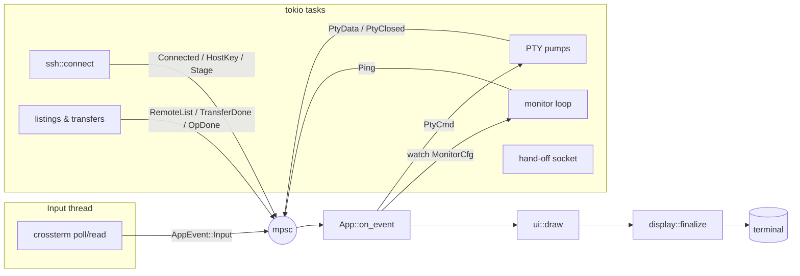

# Architecture

RSH is a single binary: a ratatui front end on a tokio runtime, with every network operation running as a
background task that reports back through one event channel. The UI thread never waits on the network.



The main loop (`main.rs`) redraws, waits for either an event or a 100 ms tick, then drains up to 1024 queued events
before the next frame, so a flood of terminal output never stalls input. External programs (editor, pager) run by
pausing the input thread, restoring the terminal and resuming afterwards.

## Modules

| Module | Responsibility |
|---|---|
| `main.rs` | CLI (`clap`), main loop, suspend/resume for external programs, `cp`/`list`/`import` commands |
| `app.rs` | All state and behaviour: screens, sessions, dialogs, connect flow, SFTP operations, settings |
| `ui.rs` | Pure rendering of every screen from `&mut App` (the only mutation is scroll offsets) |
| `dialog.rs` | Modal dialog types, the host form model, dialog rendering |
| `widgets.rs` | Text input, panels, key chips, gradient text, progress bars, sparklines |
| `display.rs` | Colour depth, TTY mode and border style. `finalize` downgrades the finished frame in one pass |
| `theme.rs` | 18 palettes and the active-theme global |
| `i18n.rs` | Russian/English string table, `t("key")` |
| `ssh.rs` | `russh` handler: host key policy, kex info, banner; auth strategies; PTY pump; byte-counting transport |
| `sftp.rs` | Panel model (sort, filter, marks), local/remote listings, recursive transfer engine with progress |
| `scp.rs` | Legacy SCP protocol over an exec channel, used by `rsh cp --scp` |
| `term.rs` | Embedded terminal: `vt100` parser → ratatui buffer, xterm key encoding, scrollback, bracketed paste |
| `monitor.rs` | TCP/ICMP probes, per-host status history, reconfigurable background loop |
| `vault.rs` | Argon2id key derivation, XChaCha20-Poly1305 sealing, master password rotation |
| `handoff.rs` | Unix-socket one-time credential tickets for <kbd>w</kbd> windows |
| `store.rs` | Host tree model, flattening for the UI, moves, `~/.ssh/config` import |
| `config.rs` | `Settings`, config paths |
| `event.rs` | `AppEvent`, the single message type from tasks to the UI |
| `util.rs` | Formatting, paths, atomic `0600` writes |
| `platform.rs` | OS differences: file modes, private files, editor/pager launch, process detaching, ping flags. The hand-off transport and ssh-agent selection have their own `cfg` blocks |

## Life of a connection

1. `App::connect` decides which secrets the host needs. If the vault is locked it pushes an unlock dialog and parks
   a `Pending::Connect`, which runs again after unlock. *Ask* hosts get a password prompt instead.
2. `open_session` creates the tab, then a task runs `ssh::connect`: TCP connect with a timeout, handshake over a
   `Counting` stream wrapper (that's where the <kbd>F1</kbd> throughput numbers come from), host key check (which can
   send `AppEvent::HostKey` with a oneshot reply and wait for the user), then authentication.
3. On success the task sends `Connected` with an `Arc<Handle>`, opens a PTY channel and hands its write side
   (`PtyCmd` sender) to the UI. The pump task forwards channel data as `PtyData` events.
4. <kbd>F2</kbd> opens a second channel on the same handle with the `sftp` subsystem. <kbd>F3</kbd> opens a third
   PTY channel for the console. Everything shares one TCP connection.
5. Every 3 seconds each live session sends an SSH keepalive ping. Its round-trip time feeds the diagnostics bar and
   the host's monitoring history.

## Rendering pipeline

Widgets draw with full RGB colours and Unicode glyphs from the active theme. `display::finalize` then walks the frame
buffer once:

- **256 / 16 colours**: every RGB cell colour maps to the nearest xterm-256 index (cube or grey ramp), or to the
  nearest of the 16 ANSI colours using a brightness-weighted distance.
- **TTY mode**: box drawing, blocks, arrows, braille spinners, status dots and emoji are transliterated to ASCII.
  Letters (including Cyrillic) are left alone. Wide glyphs that become one ASCII character get their second cell blanked.

Doing it last means no widget needs to know about terminal capabilities, and remote program output gets the same
treatment.

## Testing

```bash
cargo test            # unit tests: vault crypto, tree ops, key encoding, colour reduction, paths, sorting
cargo clippy          # kept at zero warnings
```

For end-to-end checks, run an unprivileged `sshd` on a high port with its own host key and `authorized_keys`, point RSH
at a scratch config with `RSH_CONFIG_DIR`, and drive it through `tmux send-keys` / `tmux capture-pane`.
